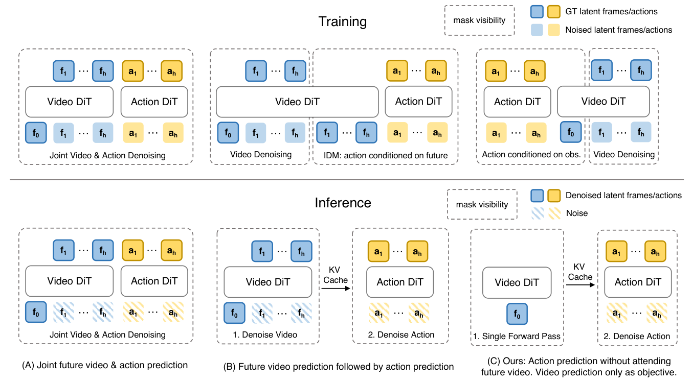
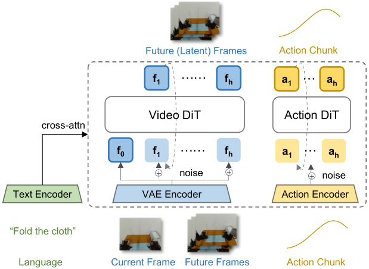
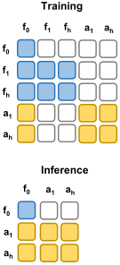

# Fast-WAM

**Can predicting the future help an action that never sees it?**

A demonstration of opening a slider bag supplies two targets. Given a picture of the gripper touching the slider and a language instruction, predict both the next robot commands and what the gripper and bag will look like during the pull. Fast-WAM shares the representation of the first frame between these two tasks. The visual features used by the deployed policy have therefore been trained to support motion prediction.

*Follow the video and action branches in each row. In the last row, future video is present only during training.*

## What can each branch read?

The camera views are tiled together and compressed into visual tokens by the pretrained Wan2.2 video encoder. The first frame stays clean. The future video and action chunk are each mixed with noise. Both branches read the first frame and the instruction. The attention mask lets action tokens attend to one another and to the first frame. The first frame itself reads only its own visual tokens, closing the indirect path by which the demonstrated outcome could leak into action prediction.

*The video backbone and action expert share the first observation. Each branch receives its own noisy target.*

$$
L=L_{\mathrm{action}}+\lambda L_{\mathrm{video}}
$$

Both terms use flow matching. The model learns a direction of update for an example interpolated between a clean training target and random noise. At inference, a succession of updates turns noise into a sample.

During a forward pass, future video is hidden from the action expert. During backpropagation, the video loss can update the network that represents the first frame. In the bag example, the point of contact matters for predicting whether the slider or the whole bag will move. The video objective gives the backbone a reason to retain that relationship in the features supplied to the policy.

*Compare the training and inference masks and trace the connections from action tokens to the first frame.*

## Which computation disappears at deployment?

The video backbone processes the current observation once. The action expert repeatedly updates an initially noisy action chunk using those features. In the paper's implementation, ten denoising iterations generate 32 control steps. One number counts model updates and the other counts commands. The future video tokens and their denoising iterations are omitted from this path.
