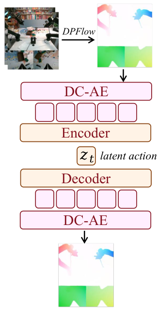
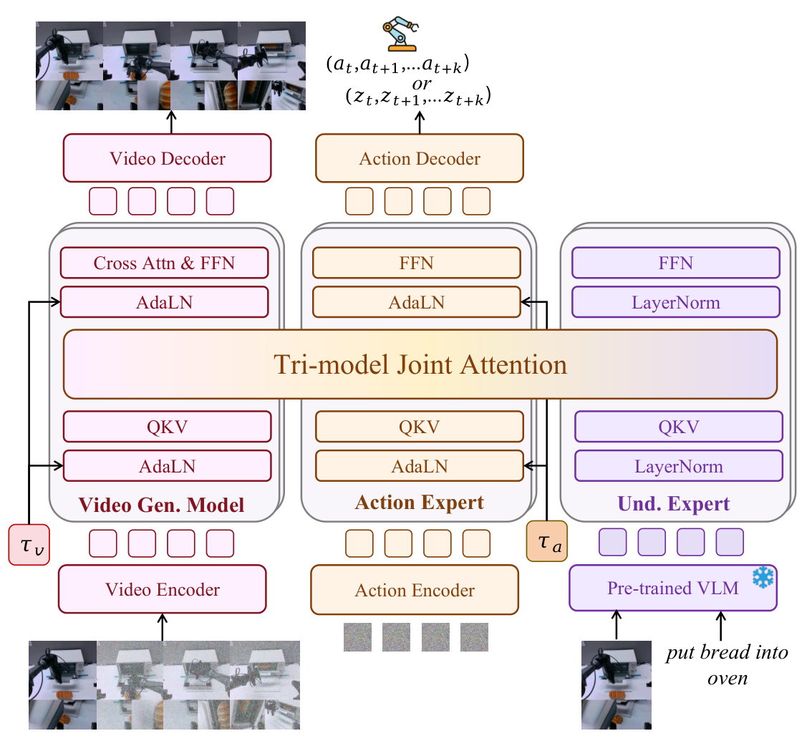
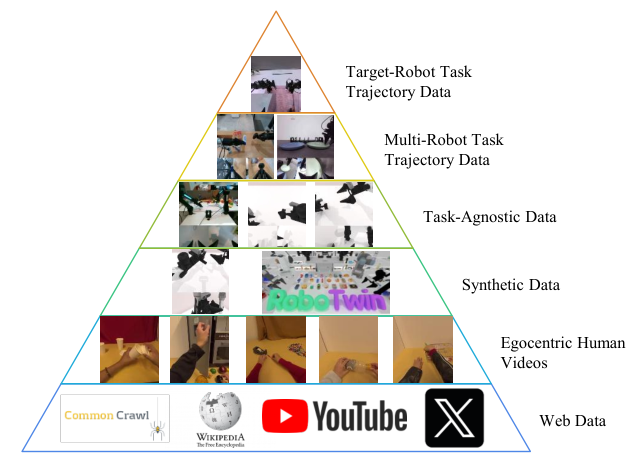
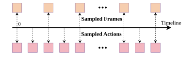

# Motus

**What can the action expert learn from a video of a human hand?**

A phone recording shows a hand pulling right, the slider moving and the bag opening. It contains no robot commands. Motus constructs a **latent action** that summarizes visible motion. This provides a pretraining target for the action expert. Demonstrations from the target robot later teach it to output executable controls. [Motus §4.2](https://arxiv.org/html/2512.13030#S4.SS2)

## How can two images supply action supervision?

Optical flow estimates how far and in what direction individual image points move between frames. An encoder compresses the flow into a 14-dimensional vector. One objective requires reconstructing the flow from this representation. A second objective uses trajectories with recorded controls to align the representation with real actions. Different joint motions can produce similar pixel displacements, which is why even a small amount of paired supervision matters here. [Motus paper](https://arxiv.org/html/2512.13030#S4.F3)

*Trace the optical-flow reconstruction path, then locate the action supervision supplied by labeled trajectories.* [Motus paper](https://arxiv.org/html/2512.13030v2#S4.F3)

## How do the three experts learn together?

The understanding expert uses Qwen3-VL features to ground the instruction in the scene. The video expert starts from Wan2.2 and predicts scene changes. The action expert models more densely sampled controls over the same interval. They exchange information through joint attention and keep separate modality-specific layers. Training first adapts the video generator to manipulation footage, then pairs video and language with extracted latent actions to pretrain the action expert and other trainable modules. Finally the target robot's demonstrations supply real control targets. Flow extraction belongs to data preparation, so a current image suffices as a visual input at deployment. [Motus §4.1](https://arxiv.org/html/2512.13030#S4.SS1) [Motus §4.3](https://arxiv.org/html/2512.13030#S4.SS3)

*The experts exchange information through joint attention. Video and action carry separate noise levels.* [Motus paper](https://arxiv.org/html/2512.13030v2#S1.F1)

*Read from the broad visual experience at the base toward increasingly robot-specific supervision at the top.* [Motus paper](https://arxiv.org/html/2512.13030v2#S4.F4)

## How can one model answer five questions?

Video and action have separate noise schedules. A known modality can remain fixed and clean as a condition for the other. For direct action prediction, the unknown future video stays at pure noise while the model updates the actions. Updating both modalities from noise produces a paired video and action sample. All five modes below receive the current observation and instruction. [Motus §7.1](https://arxiv.org/html/2512.13030#S7.SS1)

*Over the same interval, a few predicted video frames accompany a denser sequence of control samples.* [Motus paper](https://arxiv.org/html/2512.13030v2#S4.F2)

| Mode | Additional input | Question |
| --- | --- | --- |
| Video generation | None | What might opening the bag look like? |
| Forward dynamics | An action chunk | How will the bag move if we pull this way? |
| Inverse dynamics | Subsequent observations | Which controls could produce that change? |
| Direct policy | None | Which action should we execute? |
| Joint prediction | None | Which video and corresponding actions might occur together? |
