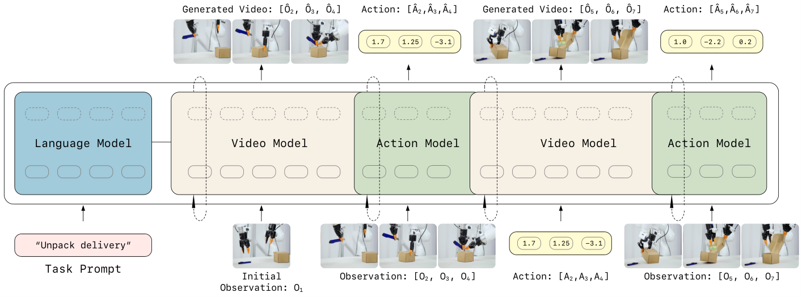
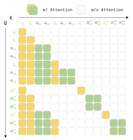
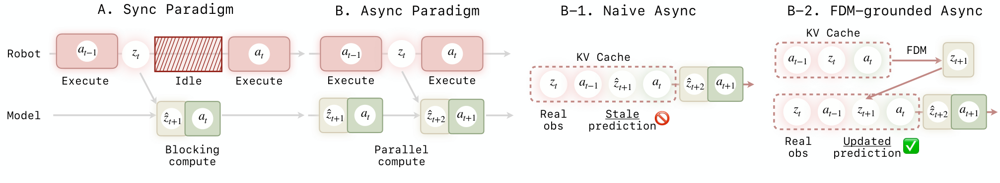

# LingBot-VA

**Where should the next action start while the gripper is still pulling?**

The gripper is moving along the bag while the controller prepares its next action. It needs to know where the slider will be when the current motion ends, a moment the camera has yet to see. LingBot-VA distinguishes the latest observed image, the action in flight and the estimated visual state at its endpoint. [LingBot-VA paper](https://arxiv.org/html/2601.21998v2#S3.F4)

## Predict a visual change, then infer the action

The video stream encodes camera frames as latent tokens. A narrower action stream projects control vectors into tokens and exchanges information with the video stream through attention. Given the instruction and the history of observations and executed actions, the video stream first predicts the next visual chunk. The action stream reads the start and the predicted change to infer controls that could connect them. This is inverse dynamics. A predicted slider endpoint farther to the right gives the action stream a different condition even when the start is identical. [LingBot-VA §3.2](https://arxiv.org/html/2601.21998v2#S3.SS2)

*The visual stream predicts the next segment. The action stream uses the start and predicted visual change to infer controls.* [LingBot-VA paper](https://arxiv.org/html/2601.21998v2#S2.F2)

Training brings robot trajectories into a common action format for end-effector pose, joints and gripper opening. Each demonstration is split into chunks. The model uses recorded history as context, masks later chunks and can generate tokens within a chunk in parallel. Adding noise to some visual history teaches the action stream to read useful movement information from partially denoised representations. At deployment, video denoising can stop halfway along its flow path while actions finish denoising. [LingBot-VA §3.3](https://arxiv.org/html/2601.21998v2#S3.SS3) [LingBot-VA §4.1](https://arxiv.org/html/2601.21998v2#S4.SS1)

*Follow the time direction of the mask to see which past tokens are available when predicting the current chunk.* [LingBot-VA paper](https://arxiv.org/html/2601.21998v2#S3.F3)

## Forward dynamics during asynchronous execution

In synchronous operation, the robot can finish a chunk and add the real observations and executed actions to the attention cache before predicting again. The cache stores features computed for past tokens. Computing the next chunk early removes access to the real endpoint. Reusing an old visual forecast could then carry forward an earlier error about where the slider is. [LingBot-VA §3.4](https://arxiv.org/html/2601.21998v2#S3.SS4)

The latest camera feedback and the action in flight provide a fresh estimate of the current endpoint. From there the model predicts the following visual chunk and infers the next action. The first step uses forward dynamics to predict an effect. The last step uses inverse dynamics to infer a cause.

Suppose the newest image already shows that the gripper has drifted off the slider. Combining that image with the command currently being executed changes the estimated start of the following chunk. The estimate can be corrected again when fresh feedback arrives. The paper's asynchronous implementation uses a short recent context for this calculation. [LingBot-VA paper](https://arxiv.org/html/2601.21998v2#S3.F4)

*Compare B-1 and B-2. The latter recomputes the next starting state from real feedback and the action in flight.* [LingBot-VA paper](https://arxiv.org/html/2601.21998v2#S3.F4)
