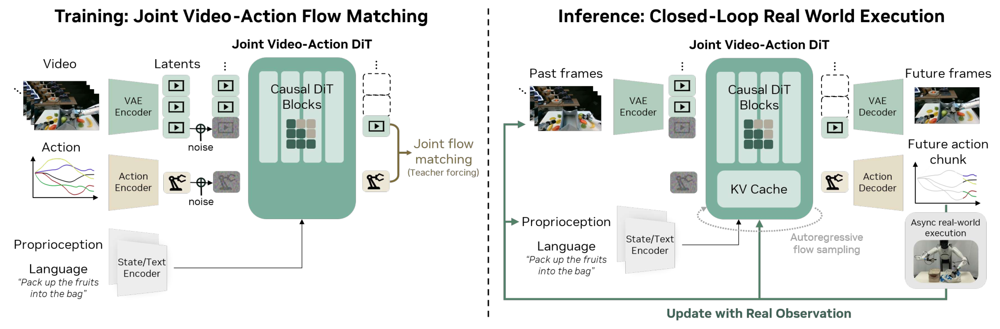
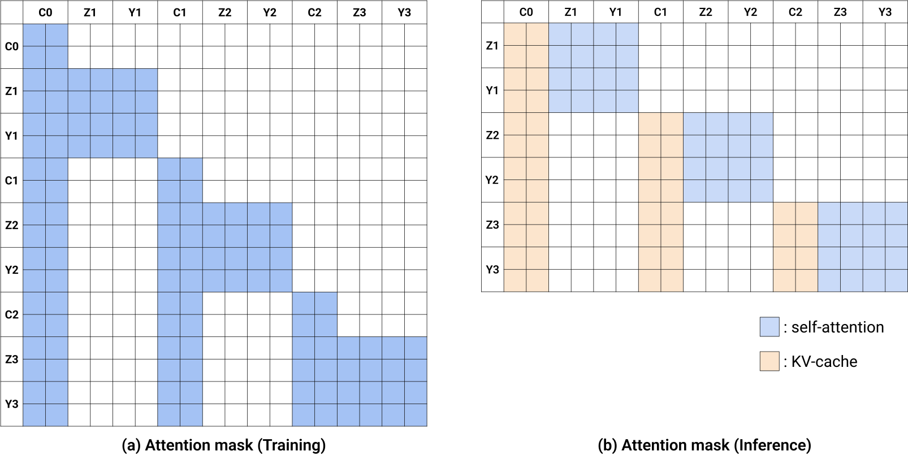
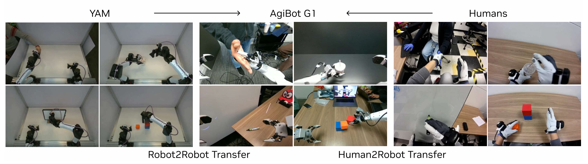
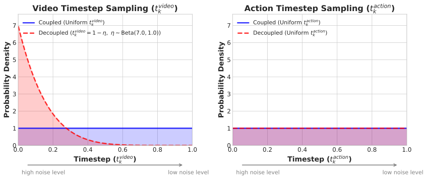

# DreamZero

**How can one denoising process produce both video and action?**

DreamZero aligns two records of a demonstration in time. Cameras see the slider move along the bag while the robot records the corresponding wrist and gripper controls. A single diffusion Transformer completes both sequences. At deployment the expected motion and its associated controls are outputs of the same generation process. [DreamZero §3.1](https://arxiv.org/html/2602.15922#S3.SS1)

## Where does joint generation happen?

The backbone is the 14B Wan2.1 image-to-video model. Camera views are tiled into one image and encoded as video latents. Language and current proprioception also enter the model, giving it access to robot state that the cameras may not reveal. Training divides a trajectory into chunks and conditions the current chunk on clean past context. In standard DreamZero, video and action in a chunk receive the same noise level. Each iteration predicts updates to both, so the actions start taking shape while the visual future is still forming. [DreamZero §3.1](https://arxiv.org/html/2602.15922#S3.SS1) [DreamZero §4.1](https://arxiv.org/html/2602.15922#S4.SS1)

*Visual history, language and robot state enter one backbone that generates the future video and controls for the same chunk.* [DreamZero paper](https://arxiv.org/html/2602.15922v1#S2.F4)

## What happens after an incorrect prediction?

Video and actions denoise together within a chunk. Across chunks, the policy carries forward visual history. Suppose the model predicted the slider would reach the middle of the bag, but the execution actually dragged the entire bag. The next round replaces the corresponding forecast in the attention cache with an encoding of what the camera actually saw. The shifted bag is now part of the conditioning context. A successful recovery still depends on the actions the policy can generate. [DreamZero paper](https://arxiv.org/html/2602.15922#A3.F14) [DreamZero §3.1](https://arxiv.org/html/2602.15922#S3.SS1)

*Distinguish the clean history used in training from the cache updated with camera observations at inference.* [DreamZero paper](https://arxiv.org/html/2602.15922v1#A3.F14)

## What can a video without action labels teach?

In the cross-embodiment setting, recordings of a human or another robot contribute only to the video prediction objective. They are mixed with trajectories from the target robot that continue to supervise both video and action. Motus would derive a latent action from the optical flow in that same extra clip. In DreamZero, the clip changes the shared backbone through its visual prediction error. [DreamZero §5.1](https://arxiv.org/html/2602.15922#S5.SS1.SSS0.Px4) [Motus §4.2](https://arxiv.org/html/2512.13030#S4.SS2)

*Another robot or a human supplies demonstration video. The target robot's trajectories still supply action labels.* [DreamZero paper](https://arxiv.org/html/2602.15922v1#S5.F11)

**What changes in DreamZero-Flash?** Standard DreamZero gives video and action in a chunk the same noise level. Flash separates their training schedules and presents noisier video when learning to produce clean actions. With fewer inference steps the action predictor can therefore make use of a coarser visual forecast. [DreamZero §3.2.5](https://arxiv.org/html/2602.15922#S3.SS2.SSS5)

*Compare the training schedules. Flash exposes the action predictor to video at higher noise levels.* [DreamZero paper](https://arxiv.org/html/2602.15922v1#S3.F5)
