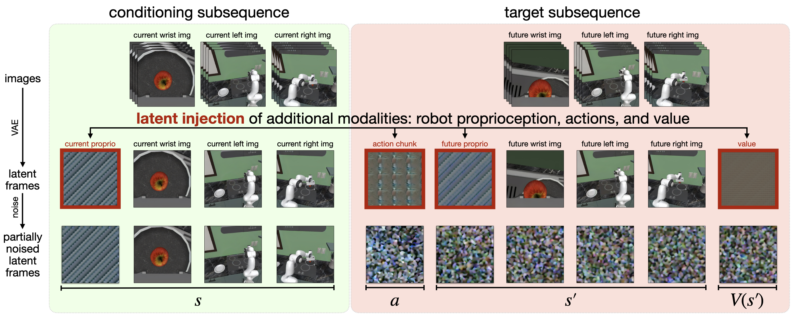
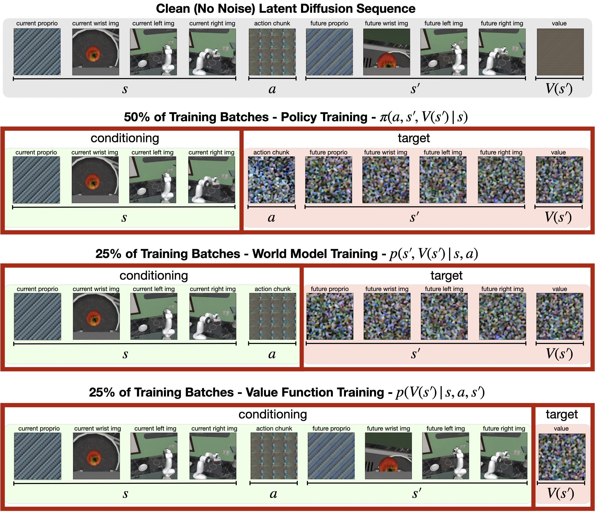
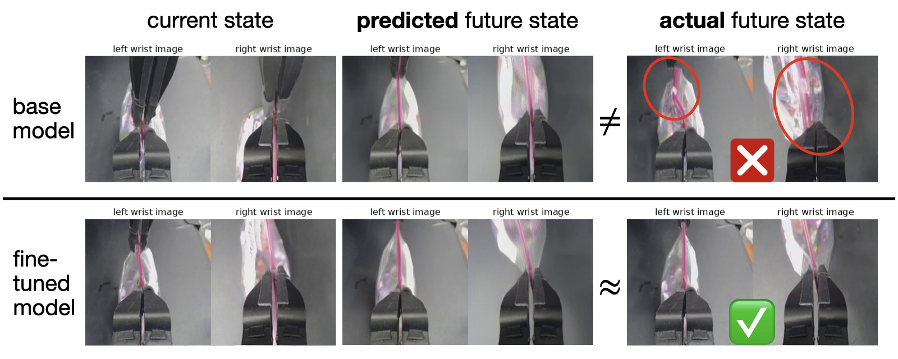

# Cosmos Policy

**How can predicted endpoints choose between two ways of pulling?**

Suppose a policy proposes pulling the slider horizontally or lifting it slightly before pulling. Choosing in advance requires predicting where each pull might leave the bag and judging how useful that state would be for the task. Cosmos Policy trains one video diffusion architecture to propose an action, predict its consequences and estimate value. [Cosmos Policy §4](https://arxiv.org/html/2601.16163#S4)

## Where can a video model put controls and value?

Cosmos-Predict2 normally operates on a sequence of compressed video frames. The authors keep the backbone and assign additional frame slots to robot data. Camera images go through the visual encoder. Numeric proprioception, an action chunk or a scalar value is normalized and repeated to fill a tensor of the same shape as a visual latent frame. Slot position identifies the modality. This lets the existing diffusion network generate numeric actions without an additional action expert. [Cosmos Policy §4.1](https://arxiv.org/html/2601.16163#S4.SS1)

A sequence contains the current state $s$, an action chunk $A$, the endpoint state $s'$ and its value. Each state includes proprioception and camera views. The two visual snapshots are separated by an entire chunk of control commands.

*Identify the slots for proprioception, camera views, the action chunk and the value of the endpoint.* [Cosmos Policy paper](https://arxiv.org/html/2601.16163v1#S3.F2)

## How does one trajectory teach three functions?

Given only the initial state, the model learns to generate actions, the endpoint and its value. Providing the action too turns the target into the resulting state and value. If the endpoint is also supplied, only value remains to be estimated. The value target comes from the discounted outcome of the recorded episode. For direct control the model can generate the outputs in parallel and send just the actions to the robot. [Cosmos Policy §4.2](https://arxiv.org/html/2601.16163#S4.SS2)

*The fixed prefix changes by row. The slots left to predict determine whether the update trains policy, dynamics or value.* [Cosmos Policy paper](https://arxiv.org/html/2601.16163v1#A1.F12)

## Why use the policy's own failed attempts for planning?

Successful demonstrations teach good action proposals. Recognizing a pull during which the gripper slips off the slider also requires experience with such outcomes. The authors retain the original checkpoint as a proposer and refine a copy on actual policy rollouts labeled with success, failure or partial credit. This second checkpoint specializes in predicting consequences and their values. [Cosmos Policy §4.3](https://arxiv.org/html/2601.16163#S4.SS3)

For the same initial observation, the policy samples several possible pulls. The planning model samples several endpoints per proposal and several values per endpoint. A threshold splits an action's value predictions into successful and unsuccessful groups. The planner averages the values in the majority group and executes the chunk with the highest resulting score. A forecast showing the whole bag sliding can therefore change which command reaches the robot. [Cosmos Policy §4.3](https://arxiv.org/html/2601.16163#S4.SS3) [Cosmos Policy paper](https://arxiv.org/html/2601.16163#S5.F6)

*Find where the gripper loses the slider and compare the two models' forecasts for that action.* [Cosmos Policy paper](https://arxiv.org/html/2601.16163v1#S5.F6)
