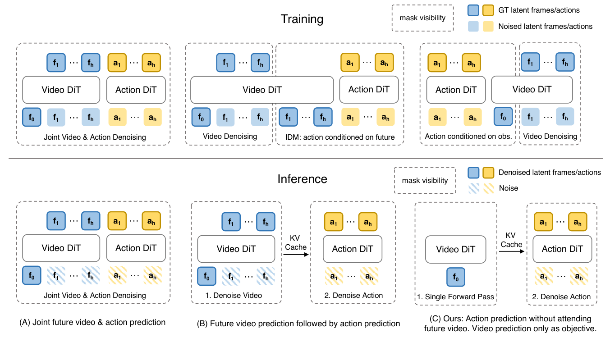
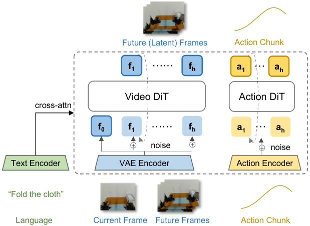
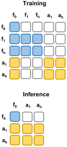

# Fast-WAM

**미래 영상을 보지 않는 정책에 미래 예측이 어떻게 도움이 될까요?**

슬라이더 지퍼백을 여는 시범 하나로 두 가지 목표를 만들 수 있습니다. 그리퍼가 슬라이더에 닿은 사진과 지시를 주고, 앞으로 보낼 제어 명령과 당기는 동안 그리퍼와 봉투가 어떻게 보일지 각각 예측하게 합니다. Fast-WAM에서는 두 분기가 첫 프레임의 표현을 공유합니다. 배포 시 행동 정책이 읽는 시각 특징에는 움직임을 예측하는 훈련의 영향이 남습니다.

*각 행에서 영상과 행동을 생성하는 순서를 따라가 보세요. 마지막 행의 미래 영상은 학습할 때만 등장합니다.*

## 두 분기는 무엇을 볼 수 있을까요?

여러 카메라의 영상을 한 화면에 나란히 붙인 뒤 Wan2.2 영상 인코더로 압축합니다. 첫 프레임은 깨끗하게 두고 이후 영상과 행동 구간에는 각각 잡음을 섞습니다. 두 분기 모두 첫 프레임과 지시를 읽습니다. 어텐션 마스크를 통해 행동 토큰은 첫 프레임과 같은 구간의 행동 토큰만 참조할 수 있습니다. 첫 프레임의 시각 토큰끼리만 서로 참조하므로 실제 시범의 결과가 첫 프레임을 거쳐 간접적으로 전달될 수도 없습니다.

*영상 백본과 행동 전문가는 첫 관측을 공유하고, 각 분기는 서로 다른 잡음 섞인 목표값을 받습니다.*

$$
L=L_{\mathrm{action}}+\lambda L_{\mathrm{video}}
$$

두 항 모두 플로 매칭을 사용합니다. 실제 목표와 무작위 잡음을 섞은 지점에서 어떤 방향으로 움직여야 하는지 학습하고, 추론 시 이 갱신을 반복해 잡음에서 행동 또는 영상 표현을 생성합니다.

순전파에서는 행동 전문가가 미래 영상을 볼 수 없습니다. 반면 역전파에서는 영상 예측 오차가 첫 프레임을 표현하는 네트워크까지 전달됩니다. 그리퍼가 슬라이더의 어디에 닿았는지에 따라 슬라이더만 움직일 수도, 봉투 전체가 끌려올 수도 있습니다. 영상 예측 목표는 이 관계를 첫 프레임의 특징에 남겨 두도록 유도합니다.

*학습과 추론 마스크에서 행동 토큰이 첫 프레임의 어떤 위치를 참조하는지 비교해 보세요.*

## 배포할 때 어떤 계산이 줄어들까요?

영상 백본은 현재 관측을 한 번만 처리합니다. 행동 전문가는 이 특징을 조건으로 잡음에서 출발해 행동 구간을 반복 갱신합니다. 논문의 설정에서는 열 번의 잡음 제거로 32개 제어 스텝을 만듭니다. 전자는 모델의 반복 횟수이고 후자는 로봇이 받는 명령의 길이입니다. 이 경로에서는 미래 영상 토큰을 만들거나 그 잡음을 제거할 필요가 없습니다.
