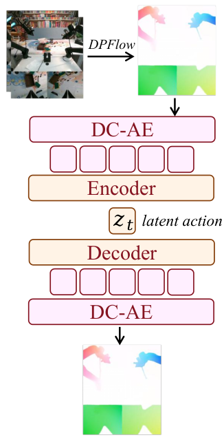
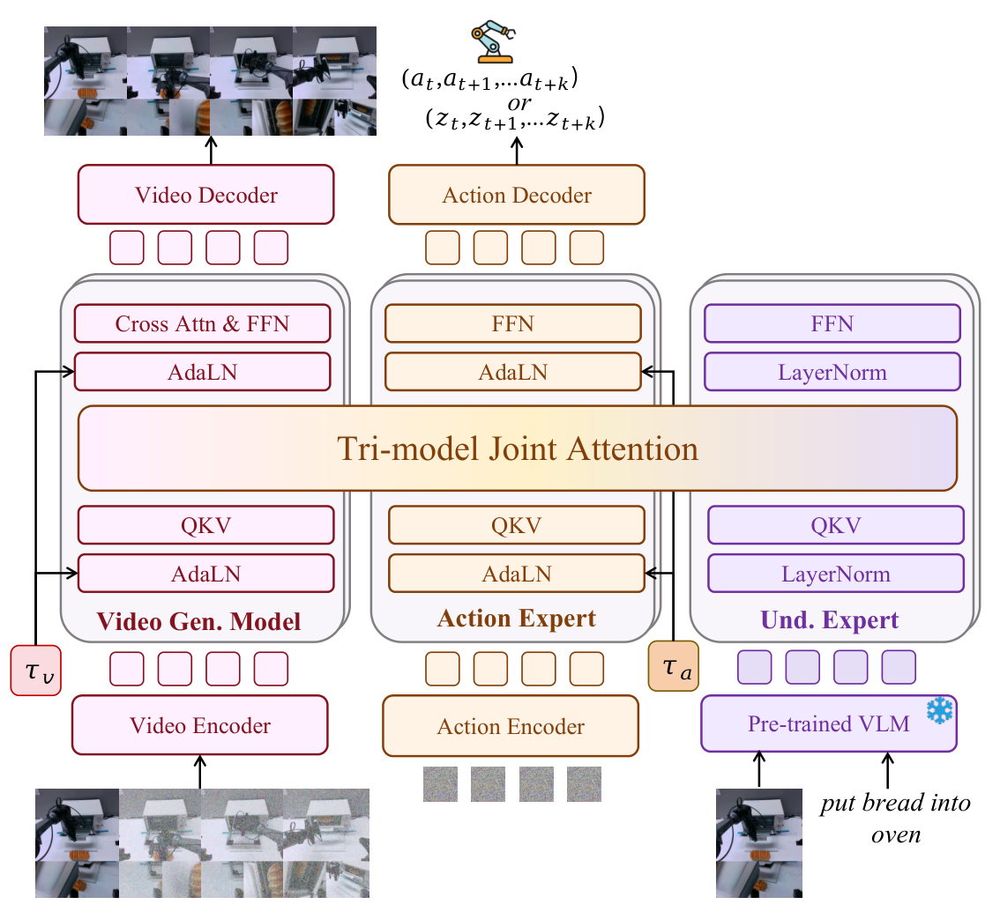
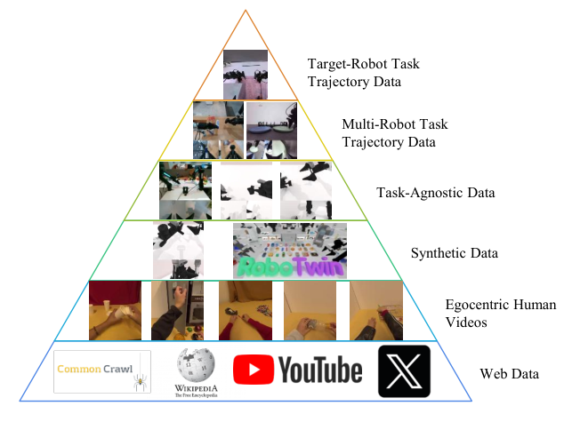
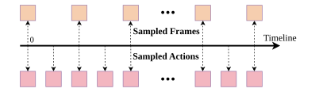

# Motus

**사람 손이 봉투를 당기는 영상에서 행동 전문가는 무엇을 배울까요?**

휴대전화 영상에는 손이 오른쪽으로 이동하고 슬라이더가 따라가며 봉투가 열리는 모습이 담깁니다. 로봇의 제어 명령은 기록되지 않습니다. Motus는 보이는 움직임을 요약하는 **잠재 행동**을 만들어 행동 전문가의 사전학습 목표로 사용합니다. 이후 목표 로봇의 시범으로 실제 실행 가능한 명령을 출력하도록 조정합니다. [Motus §4.2](https://arxiv.org/html/2512.13030#S4.SS2)

## 두 프레임에서 어떻게 행동 학습 신호를 얻을까요?

광류는 연속된 두 프레임에서 영상의 각 지점이 어느 방향으로 얼마나 이동했는지 추정합니다. 인코더는 이 변위 지도를 14차원 벡터로 압축합니다. 한 목표는 이 표현에서 광류를 복원하도록 하고, 또 다른 목표는 제어 명령을 기록한 궤적에 한해 표현을 실제 행동에 정렬합니다. 서로 다른 관절 움직임이 비슷한 화소 변위를 만들 수 있으므로 소량의 대응 데이터에도 의미가 있습니다. [Motus 원문](https://arxiv.org/html/2512.13030#S4.F3)

*광류를 인코딩하고 복원하는 경로를 따라가며 라벨이 있는 궤적이 행동 표현을 정렬하는 지점을 찾아보세요.* [Motus 원문](https://arxiv.org/html/2512.13030v2#S4.F3)

## 세 전문가는 어떻게 함께 학습할까요?

이해 전문가는 Qwen3-VL 특징으로 지시가 가리키는 물체를 찾습니다. Wan2.2에서 출발한 영상 전문가는 장면의 변화를 예측하고, 행동 전문가는 같은 시간 구간의 제어 명령을 더 촘촘히 예측합니다. 각자 고유한 층을 유지하면서 결합 어텐션으로 정보를 교환합니다. 우선 사람과 로봇의 조작 영상으로 영상 생성기를 적응시킵니다. 이어서 영상, 언어, 추출한 잠재 행동을 짝지어 행동 전문가 등 학습 대상 모듈을 사전학습합니다. 마지막에는 목표 로봇의 실제 제어 명령으로 미세조정합니다. 광류는 데이터를 준비할 때 추출하므로 온라인 실행에는 현재 영상 한 장만 시각 입력으로 줄 수 있습니다. [Motus §4.1](https://arxiv.org/html/2512.13030#S4.SS1) [Motus §4.3](https://arxiv.org/html/2512.13030#S4.SS3)

*세 전문가가 결합 어텐션으로 정보를 교환합니다. 영상과 행동에는 서로 다른 잡음 수준을 쓸 수 있습니다.* [Motus 원문](https://arxiv.org/html/2512.13030v2#S1.F1)

*아래에서 위로 갈수록 폭넓은 영상 경험에서 목표 로봇에 특화된 데이터로 바뀝니다.* [Motus 원문](https://arxiv.org/html/2512.13030v2#S4.F4)

## 같은 가중치로 어떻게 다섯 가지 질문에 답할까요?

영상과 행동의 잡음 수준을 독립적으로 정합니다. 한쪽을 알고 있다면 깨끗한 상태로 고정해 다른 쪽의 조건으로 씁니다. 행동만 예측하려면 미래 영상 쪽은 순수 잡음으로 두고 행동만 갱신합니다. 양쪽을 잡음에서 시작해 함께 갱신하면 서로 대응하는 영상과 행동이 나옵니다. 다음 다섯 모드에는 공통으로 현재 관측과 지시가 주어집니다. [Motus §7.1](https://arxiv.org/html/2512.13030#S7.SS1)

*같은 시간 구간에서 영상 프레임은 드물게 예측하고 행동은 더 촘촘하게 예측합니다.* [Motus 원문](https://arxiv.org/html/2512.13030v2#S4.F2)

| 모드 | 추가 입력 | 질문 |
| --- | --- | --- |
| 영상 생성 | 없음 | 봉투가 열리는 과정은 어떻게 보일까요? |
| 순동역학 | 행동 구간 | 이 방향으로 당기면 봉투가 어떻게 움직일까요? |
| 역동역학 | 이후의 관측 | 이 변화를 만들 제어 명령은 무엇일까요? |
| 직접 정책 | 없음 | 지금 어떤 행동을 실행할까요? |
| 결합 예측 | 없음 | 어떤 영상과 행동이 함께 나타날까요? |
