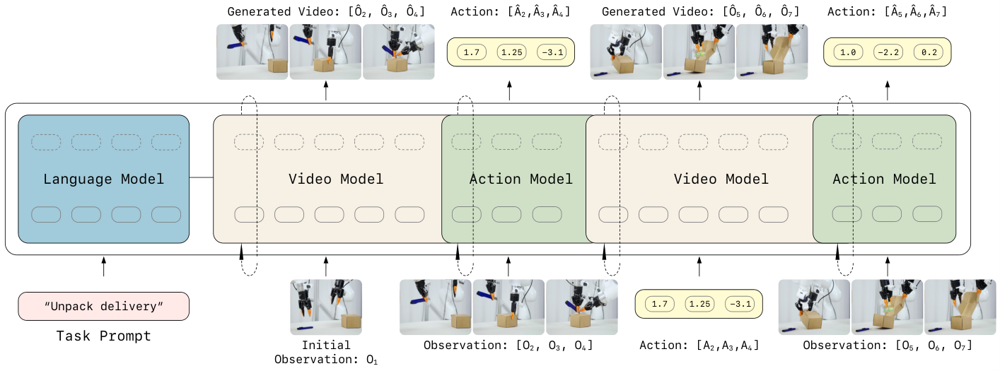
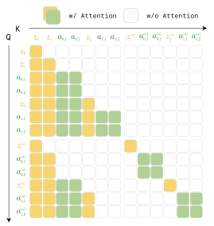
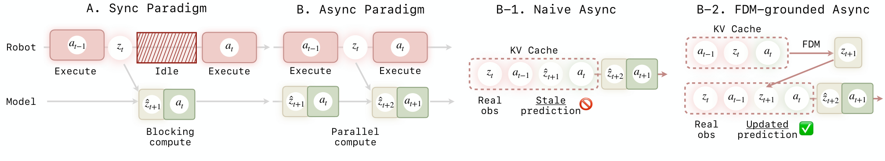

# LingBot-VA

**그리퍼가 아직 움직이는 동안 다음 행동은 어디서 시작할까요?**

그리퍼가 봉투를 따라 움직이는 동안 제어기는 다음 행동을 준비합니다. 지금의 당기기가 끝날 때 슬라이더가 어디에 있을지 알아야 하지만 카메라는 아직 그 순간을 보지 못했습니다. LingBot-VA는 최근에 관측한 영상, 실행 중인 행동, 그리고 그 행동의 종점에서 보일 것으로 추정한 상태를 구분합니다. [LingBot-VA 원문](https://arxiv.org/html/2601.21998v2#S3.F4)

## 먼저 영상 변화를 예측한 뒤 행동을 역으로 추론하기

영상 분기는 카메라 영상을 잠재 토큰으로 바꿉니다. 폭이 좁은 행동 분기는 제어 벡터를 토큰으로 바꾸고 어텐션으로 영상 분기와 정보를 교환합니다. 지시와 관측 이력, 이미 실행한 행동이 주어지면 영상 분기가 다음 구간을 예측합니다. 행동 분기는 시작 상태와 예측된 변화를 읽고 둘을 연결할 제어 명령을 추론합니다. 이것이 역동역학입니다. 출발점이 같아도 예상한 슬라이더의 종점이 더 오른쪽이면 행동 분기가 받는 조건이 달라집니다. [LingBot-VA §3.2](https://arxiv.org/html/2601.21998v2#S3.SS2)

*영상 분기가 다음 구간을 예측하면 행동 분기가 시작 상태와 예측한 변화를 이용해 제어 명령을 추론합니다.* [LingBot-VA 원문](https://arxiv.org/html/2601.21998v2#S2.F2)

학습에는 여러 로봇의 궤적을 사용하며 말단 자세, 관절, 그리퍼 개폐를 공통 형식으로 정리합니다. 시범을 짧은 구간으로 나눈 뒤 기록된 과거를 조건으로 주고 마스크로 이후 구간을 가립니다. 같은 구간의 토큰은 병렬로 생성할 수 있습니다. 시각 이력 일부에 잡음을 추가하면 행동 분기는 잡음이 남아 있어도 움직임을 읽는 연습을 합니다. 배포할 때는 영상의 잡음 제거 경로를 절반만 진행한 상태에서도 행동은 끝까지 복원할 수 있습니다. [LingBot-VA §3.3](https://arxiv.org/html/2601.21998v2#S3.SS3) [LingBot-VA §4.1](https://arxiv.org/html/2601.21998v2#S4.SS1)

*마스크의 시간 방향을 따라 현재 구간을 예측할 때 참조할 수 있는 과거 토큰을 살펴보세요.* [LingBot-VA 원문](https://arxiv.org/html/2601.21998v2#S3.F3)

## 비동기 실행 중에 순동역학으로 출발점 다시 추정하기

동기식으로는 이전 행동이 끝날 때까지 기다렸다가 실제 관측과 실행한 행동을 어텐션 캐시에 넣고 다음 구간을 계산할 수 있습니다. 캐시는 이전 토큰에서 계산한 특징을 보관합니다. 계산을 앞당기면 현재 구간의 실제 종점을 알 수 없습니다. 지난번 예측을 그대로 쓰면 이미 그리퍼가 어긋났는데도 슬라이더를 계속 잡고 있다고 가정할 수 있습니다. [LingBot-VA §3.4](https://arxiv.org/html/2601.21998v2#S3.SS4)

최근 카메라 피드백과 실행 중인 행동으로 이번 구간의 종점을 다시 추정합니다. 여기에서 다음 영상 구간을 예측하고 그 변화에 맞는 행동을 추론합니다. 처음에는 순동역학으로 주어진 행동의 결과를 구하고 마지막에는 역동역학으로 원하는 변화를 만들 행동을 구합니다.

최근 영상에서 이미 그리퍼가 슬라이더를 벗어났다고 해 봅시다. 이 영상과 실행 중인 명령을 결합하면 다음 구간의 예상 출발점이 달라집니다. 추정한 종점은 새 실측 영상이 들어올 때 다시 보정할 수 있습니다. 논문의 비동기 구현은 이 계산에 최근 몇 구간의 문맥을 사용합니다. [LingBot-VA 원문](https://arxiv.org/html/2601.21998v2#S3.F4)

*B-1과 B-2를 비교해 보세요. B-2는 실제 관측과 실행 중인 행동으로 다음 구간의 시작점을 다시 추정합니다.* [LingBot-VA 원문](https://arxiv.org/html/2601.21998v2#S3.F4)
