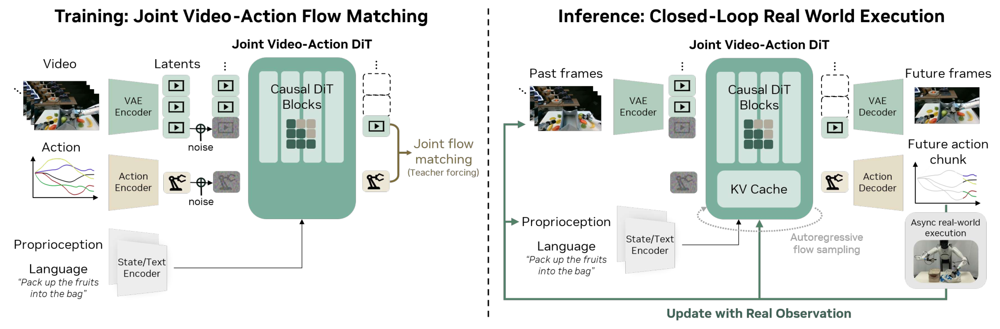
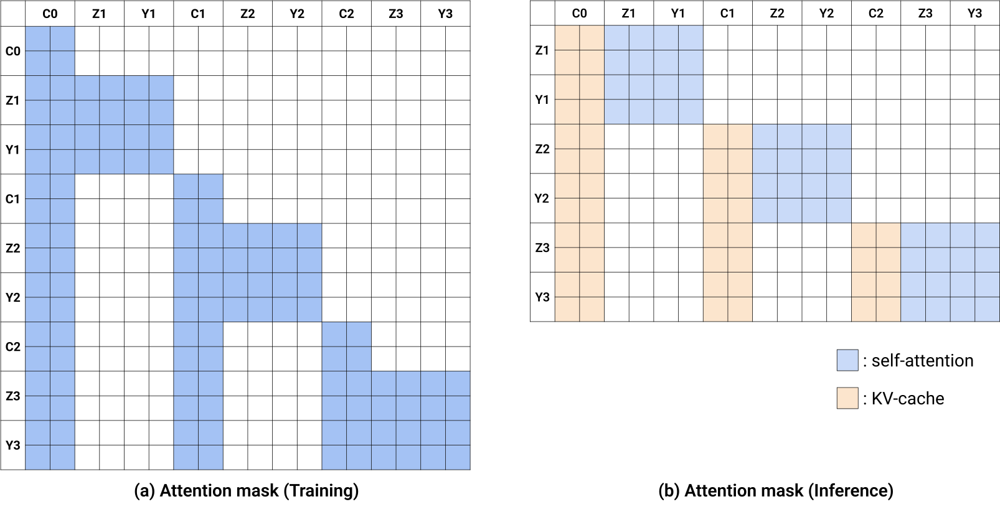
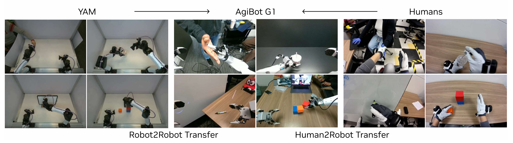
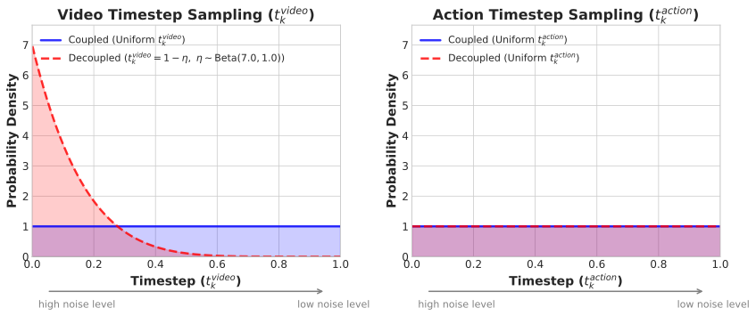

# DreamZero

**영상과 행동을 한 번의 잡음 제거 과정에서 어떻게 함께 만들까요?**

지퍼백을 여는 시범에서 슬라이더가 움직이는 영상과 그때의 손목 및 그리퍼 제어 기록을 시간상 맞춥니다. DreamZero는 하나의 확산 Transformer로 두 시퀀스를 함께 완성합니다. 실행할 때 예상되는 시각적 변화와 이에 대응하는 행동이 한 번의 생성 과정에서 나옵니다.

## 결합 생성은 어디에서 일어날까요?

백본은 140억 매개변수의 Wan2.1 이미지-비디오 모델입니다. 여러 카메라 화면을 붙인 뒤 영상 잠재 표현으로 압축합니다. 언어 지시와 현재 고유수용 상태도 입력하므로 카메라에 잘 보이지 않는 관절 위치를 활용할 수 있습니다. 궤적을 구간으로 나누고 과거의 실제 구간을 조건으로 현재의 영상과 행동에 잡음을 더합니다. 기본형은 같은 구간의 두 모달리티에 같은 잡음 수준을 씁니다. 매 반복에서 양쪽의 갱신 방향을 함께 예측하므로 행동이 형태를 갖출 때 영상도 아직 생성 중입니다.

*영상 이력, 언어 지시, 로봇 상태를 한 백본에 입력하고 같은 구간의 미래 영상과 행동을 생성합니다.*

## 직전 구간에서 예측이 틀리면 어떻게 될까요?

구간 안에서는 영상과 행동을 함께 복원하고 구간 사이에서는 시각 이력을 이어 갑니다. 모델은 슬라이더가 중간까지 이동할 것으로 예측했는데 실제로는 봉투 전체가 끌려왔다고 합시다. 다음 반복에서는 캐시의 해당 예측 영상을 실제 카메라 관측의 인코딩으로 대체합니다. 다음 행동의 전제는 이제 봉투가 옮겨진 상태입니다. 다시 잡는 데 성공할지는 그 상태에서 정책이 만들어 낼 수 있는 행동에 달려 있습니다.

*학습에 쓰는 깨끗한 이력과 추론 중 실제 카메라 관측으로 갱신하는 캐시를 구분해 보세요.*

## 행동 라벨이 없는 영상은 무엇을 가르칠까요?

다른 로봇이나 사람의 시범을 이용하는 설정에서는 추가 영상에 영상 예측 목표만 적용합니다. 목표 로봇에서 얻은 라벨 있는 궤적을 함께 사용해 영상과 행동의 대응 관계도 계속 학습합니다. Motus라면 같은 추가 영상에서 광류로 잠재 행동을 구합니다. DreamZero에서는 그 영상의 시각 예측 오차가 공유 백본을 업데이트합니다.

*다른 로봇이나 사람은 시범 영상을 제공하고, 행동 라벨은 목표 로봇의 궤적에서 얻습니다.*

**DreamZero-Flash는 무엇을 바꿀까요?** 기본형은 한 구간의 영상과 행동에 같은 잡음 수준을 줍니다. Flash는 둘의 학습 스케줄을 분리해 영상에 잡음이 많이 남아 있어도 깨끗한 행동을 복원하는 연습을 합니다. 따라서 추론 스텝이 적을 때도 거친 시각 예측을 행동 생성에 활용할 수 있습니다.

*두 학습 스케줄을 비교해 보세요. Flash는 영상에 잡음이 많이 남은 상태에서도 행동을 복원하도록 학습합니다.*
