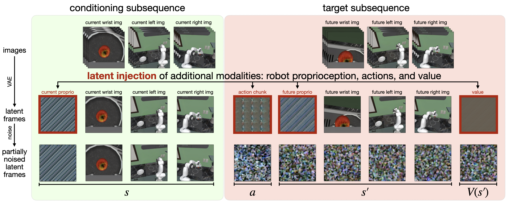
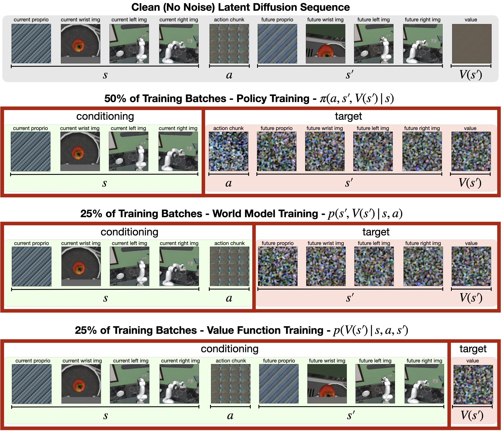
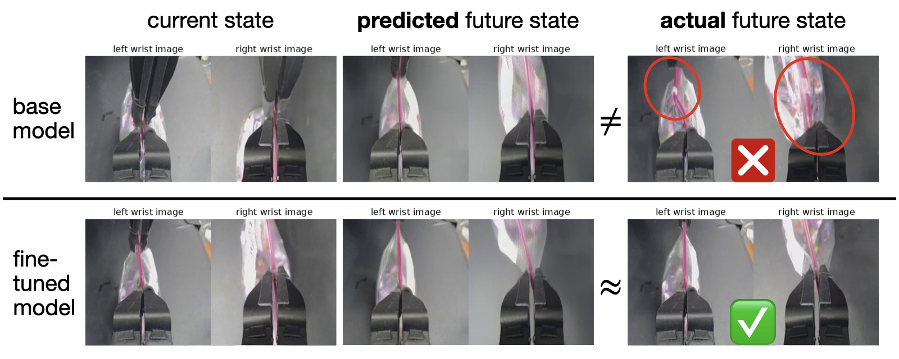

# Cosmos Policy

**당기는 방향마다 종점을 예상하면 어떻게 행동을 고를까요?**

정책이 슬라이더를 수평으로 당기는 방법과 조금 들어 올린 뒤 당기는 방법을 제안했다고 합시다. 움직이기 전에 고르려면 각 동작 뒤 봉투가 어떻게 될지, 그 결과가 목표 달성에 얼마나 유리한지 추정해야 합니다. Cosmos Policy는 하나의 영상 확산 구조로 행동 제안, 결과 예측, 가치 추정을 학습합니다.

## 영상 모델의 어디에 행동과 가치를 넣을까요?

Cosmos-Predict2는 압축한 영상 프레임의 시퀀스를 처리합니다. 저자들은 백본을 유지하고 로봇 데이터에 프레임 자리를 할당합니다. 카메라 영상은 시각 인코더를 통과합니다. 고유수용 상태와 행동 구간, 하나의 가치 점수는 수치를 정규화한 후 반복해 잠재 프레임과 같은 모양의 텐서에 채웁니다. 각 자리의 위치가 어떤 모달리티인지를 정합니다. 기존 확산 네트워크가 별도 행동 전문가 없이 수치 제어 명령을 생성할 수 있는 이유입니다.

시퀀스에는 현재 상태 $s$, 행동 구간 $A$, 종점 상태 $s'$, 종점 가치가 들어갑니다. 상태에는 로봇 자체의 상태와 카메라 관측이 포함됩니다. 현재와 종점의 두 스냅숏 사이에는 한 구간 전체의 제어 명령이 있습니다.

*고유수용 상태, 카메라 관측, 행동 구간, 종점 가치에 해당하는 프레임 위치를 찾아보세요.*

## 하나의 궤적으로 어떻게 세 기능을 학습할까요?

현재 상태만 주면 모델은 행동, 종점, 가치를 함께 예측합니다. 행동까지 주면 그 행동이 만들 상태와 가치를 예측합니다. 종점까지 알려 주면 가치만 추정합니다. 가치의 학습 목표는 궤적 끝의 성공 여부나 점수를 할인해 얻은 반환값입니다. 직접 제어할 때는 여러 출력을 병렬로 생성하고 행동만 로봇에 보내면 됩니다.

*행마다 고정하는 접두 구간이 다릅니다. 남은 예측 위치에 따라 정책, 동역학 또는 가치를 학습합니다.*

## 계획할 때 정책 자신의 실패 기록이 필요한 이유는 무엇일까요?

성공한 시범은 그럴듯한 행동을 제안하는 법을 가르칩니다. 그리퍼가 슬라이더를 놓친 상황을 알아보려면 그런 결과도 경험해야 합니다. 원래 체크포인트로 후보를 제안하고, 그 사본에는 성공, 실패 또는 부분 점수가 기록된 실제 실행 궤적을 추가로 학습시킵니다. 두 번째 체크포인트는 결과 예측과 가치 추정에 중점을 둡니다.

같은 시작 화면에서 여러 당기기 동작을 샘플링합니다. 계획 모델은 각 동작의 종점을 여러 번 예측하고 종점마다 가치를 다시 여러 번 추정합니다. 임곗값을 기준으로 가치 추정치를 성공과 실패 두 집단으로 나누고 다수 집단 안에서만 평균을 냅니다. 이 점수가 가장 높은 행동 구간을 실행하므로 슬라이더 대신 봉투 전체가 끌려가는 예측이 실제 명령을 바꿀 수 있습니다.

*그리퍼가 슬라이더를 놓치는 지점을 찾고 같은 행동의 결과를 두 모델이 어떻게 예측하는지 비교해 보세요.*
