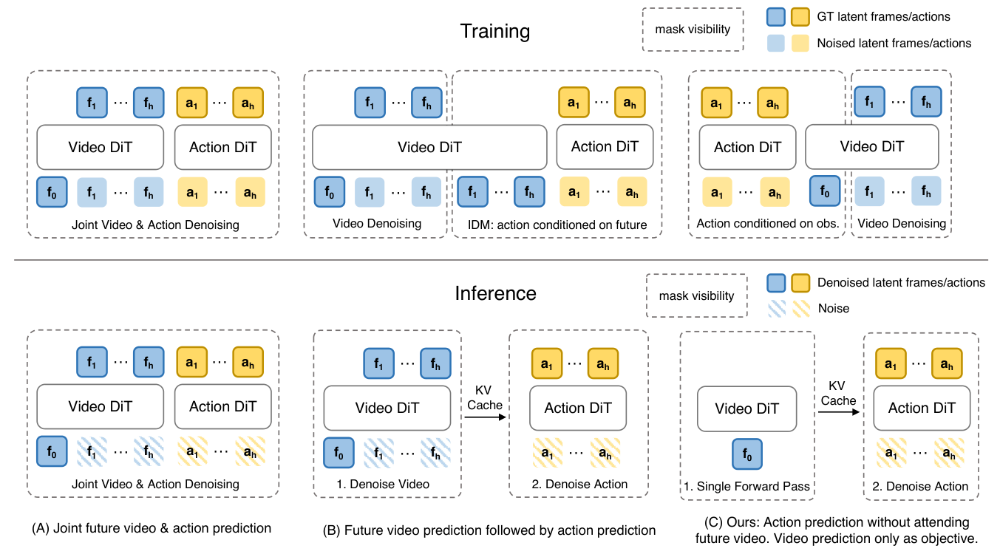
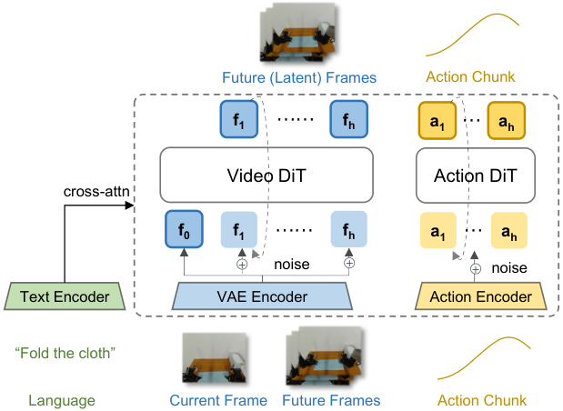
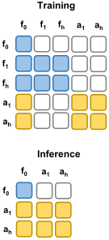

# Fast-WAM

**动作看不到未来，预测未来为什么还有用？**

从一段开密封袋的示范里，可以出两道题。只给夹爪刚碰到滑扣的画面和「打开袋子」的指令，一道题要求补出接下来的机器人指令，另一道题要求补出袋口和夹爪接下来怎么动。Fast-WAM 让两个分支共用这张起始画面的特征。训练结束后，即使只做第一道题，提取首帧特征的网络也已经从第二道题中学过物体怎样运动。

*沿三行分别看视频和动作的生成顺序，最后一行的未来视频只在训练时出现。*

## 两条分支能看到什么？

模型把多路相机画面先拼在一起，用 Wan2.2 的视频编码器压成视觉 token，也就是 Transformer 处理的一组向量。首帧保持干净，后续画面和对应的动作段分别加噪。视频分支和较小的动作专家都能读首帧和文字指令。注意力掩码规定，首帧的视觉表示只能读首帧里的其他位置，动作只能读首帧和同段的动作。这样，示范中袋口最后是否张开，连经由首帧间接透露给动作分支的路径也被切断了。

*首帧是视频主干与动作专家共用的视觉输入，两条分支分别接收自己的带噪目标。*

$$
L=L_{\mathrm{action}}+\lambda L_{\mathrm{video}}
$$

两项都用流匹配。把真实样本与随机噪声混合，模型学习沿哪个方向更新，才能从噪声逐渐还原出动作或未来画面的潜在表示。

这里要区分两条信息流。**做预测时**，未来画面不能传给动作专家。**更新权重时**，视频预测的误差却能沿着共享的首帧表示向后传播。假如画面里夹爪与滑扣的接触位置关系到袋口接下来怎么动，视频目标就给了主干一个理由，把这层关系保留在表示里。机器人自己跑起来时，动作专家能用到的正是这份表示。

*对照训练与推理的掩码，追踪动作 token 能读取的首帧位置。*

## 部署时省掉了哪部分计算？

新画面到来后，视频主干只处理一次首帧。动作专家拿着这组特征，从随机噪声开始，逐轮生成整段控制指令。以论文配置为例，10 轮去噪得到 32 步动作。前一个数是模型算了几轮，后一个数是交给机器人的序列长度。整个过程中都不用创建未来视频 token，更不用反复去噪一段「袋子被打开」的视频。
