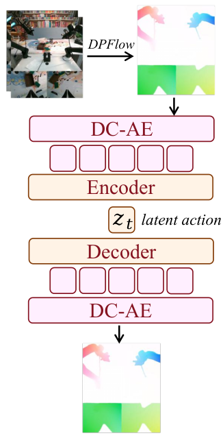
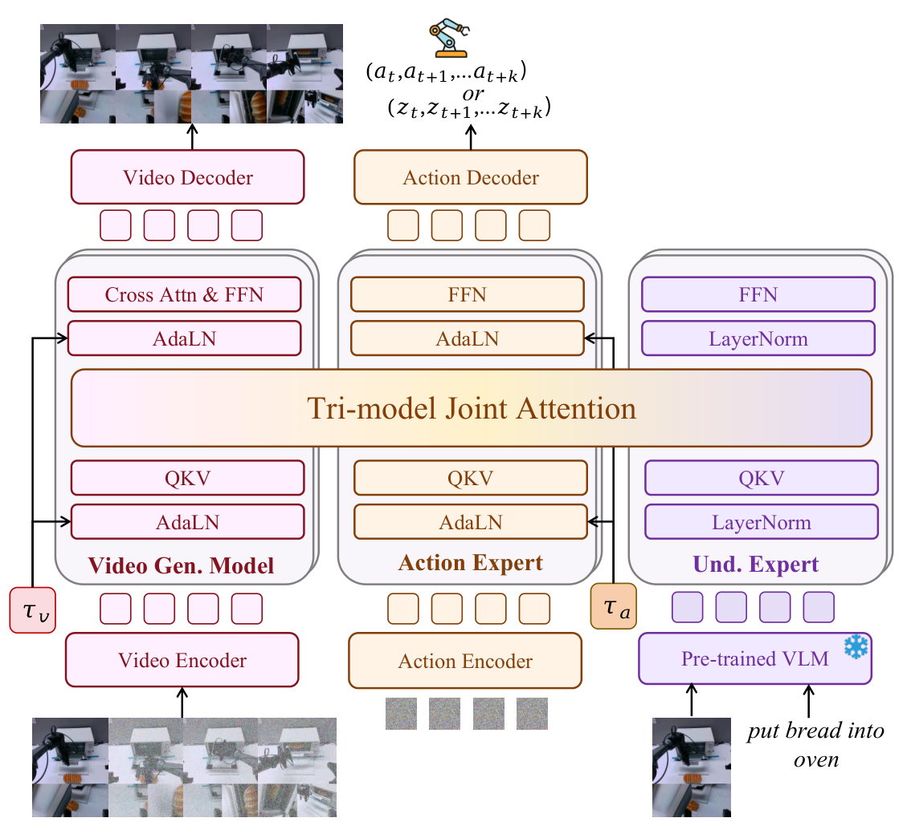
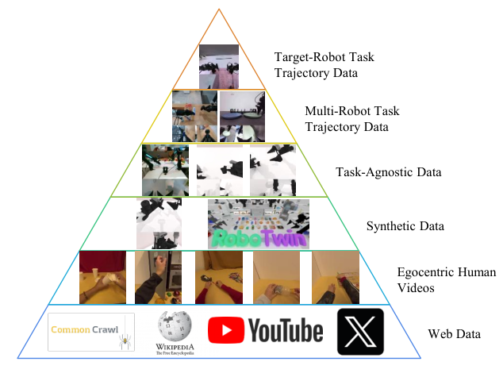
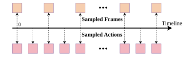

# Motus

**只有人手拉袋子的视频，动作分支学什么？**

手机拍下了一段开袋过程。它告诉我们手向右移动、滑扣跟着走、袋口逐渐分开，却没有一行机器人控制指令。Motus 为这种录像构造了一个可以预测的目标，叫作**潜在动作**。先让动作专家学会描述看得见的运动，再用目标机器人的示范教它输出能执行的指令。

## 怎样从两帧图像得到动作监督？

先估计光流，即画面上各处的像素在相邻两帧之间移了多远、往哪里移。编码器把这张稠密的位移图压成 14 维向量。训练时，一个目标要求能从压缩表示重建光流，保留运动信息。另一个目标只用于带动作标签的轨迹，让表示对齐已知的控制量。单凭画面无法唯一确定机械臂各个关节怎么转，少量配对数据给这个表示提供了物理参照。

*顺着光流的编码与重建路径看，再找有标签轨迹提供动作对齐的位置。*

## 三个专家怎样一起训练？

Qwen3-VL 为理解专家提供特征，帮助定位指令所指的物体。视频专家从 Wan2.2 起步，学习场景会怎么变。动作专家在同一段时间内预测更密集的控制序列。三者在注意力层交换信息，各自保留处理本模态的网络层。训练先让视频专家在人类操作录像和机器人轨迹上学习视觉变化，再把视频、语言和提取出的潜在动作配起来训练动作专家等模块，最后用目标机器人的示范微调，让动作专家预测实际的控制量。部署时，摄像头交来的可以只是一张当前画面，光流提取发生在准备预训练数据时。

*三个专家在联合注意力层交换信息，视频与动作各有自己的去噪时间。*

*从下往上，宽泛的视频经验逐渐过渡到更贴近目标机器人的数据。*

## 同一套权重，怎样回答五种问题？

视频和动作各有自己的去噪进度。给定某种模态时，可以把它固定在干净状态供另一方读取。想只生成动作时，可以把未来视频固定在纯噪声，只更新动作。两边都从噪声开始、都逐步更新，就得到一对相互配合的录像和动作。下表的五种问法都给定当前画面和任务指令。

*同一段时间里只预测少数视觉帧，同时保留更密集的动作采样点。*

| 模式 | 额外给定的信息 | 问题 |
| --- | --- | --- |
| 视频生成 | 无 | 接下来可能看到怎样的开袋过程？ |
| 前向动力学 | 一段动作 | 按这个方向拉，袋子会怎么动？ |
| 逆动力学 | 后续画面 | 怎样控制夹爪才能产生这段变化？ |
| 直接策略 | 无 | 现在该执行哪段动作？ |
| 联合预测 | 无 | 可能出现哪段画面，与它配套的动作是什么？ |
