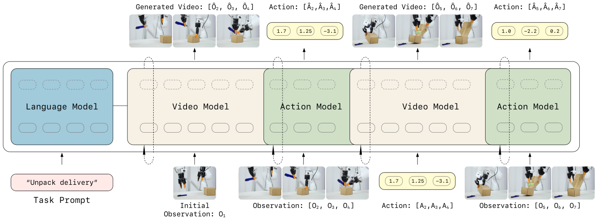
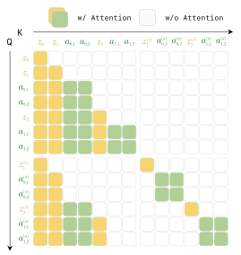
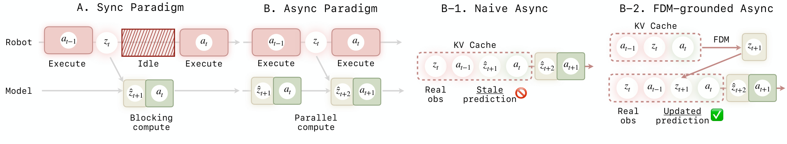

# LingBot-VA

**手臂还在拉，下一段动作该从哪幅画面开始算？**

夹爪正沿着袋口向右拉，控制器已经要准备下一段动作了。此刻最想知道的是这一拉结束时滑扣会停在哪里，可相机还拍不到那个时刻。LingBot-VA 把这个时间差写进了模型，要分清**已经看到的画面**、**正在执行的动作**和**推算出的下一幅画面**。

## 先预测视觉变化，再反推动作

视频分支把相机画面压成视觉表示，动作分支把控制向量投影成动作 token。两条分支通过注意力交换信息，较大的视频分支处理画面细节，较窄的动作分支专门处理控制。给定指令、过去看到的画面和已经执行的动作，视频分支先预测下一小段的视觉变化。动作分支随后同时读取起点和预测到的变化，推断哪段动作能把两者连起来。这就是**逆动力学**。同一帧起点，如果预测的滑扣终点更靠右，动作分支收到的条件也跟着改变。

*视觉分支先预测下一段，动作分支用起点与预测结果反推控制指令。*

训练用到不同机器人的操作轨迹。作者把末端位姿、关节和夹爪开合整理到统一的动作格式里，让相邻画面能和期间发生的控制变化配对。再把一条示范按时间切段。预测每一段时，以记录下来的历史作上下文，用注意力掩码挡住更晚的片段，同一段内的 token 则可以并行生成。训练还会给部分视觉历史加噪，使动作分支习惯从略带噪声的表示里提取位移。部署时，视频去噪到一半就可以交给动作分支，后者继续把控制指令算完整。

*沿掩码的时间方向读，注意哪些历史 token 可以参与当前段的预测。*

## 异步执行时，再做一次前向动力学

同步运行时，机器人可以等上一段执行完，把真实画面和执行过的动作写进注意力缓存，再开始算下一段。这个缓存保留了先前处理过的特征。异步运行把计算提前，当前段的真实终点便成了一个缺失量。如果沿用上轮预测的终点，一次拉偏就可能让模型继续沿着想象中的袋口规划。

先用最近的实拍画面和正在执行的动作重估本段终点，再以它为起点预测下段画面，最后反推出下段动作。

前一箭头用前向动力学回答「这么动会到哪里」，最后一箭头用逆动力学回答「要到那里该怎么动」。

举个例子，上一张实拍已经显示夹爪偏离了滑扣。模型拿这张实拍和当前正在执行的那段指令，重新估计本段将结束在哪里，再从修正后的起点往前算。这个终点仍是估计，下一次真实反馈还可以修正它。论文的异步实现只取最近几段作上下文，所以它能边动边修正，也有明确的反馈时间窗口。

*对照 B-1 和 B-2，后者在下一段推理前，用真实反馈和正在执行的动作重估起点。*
