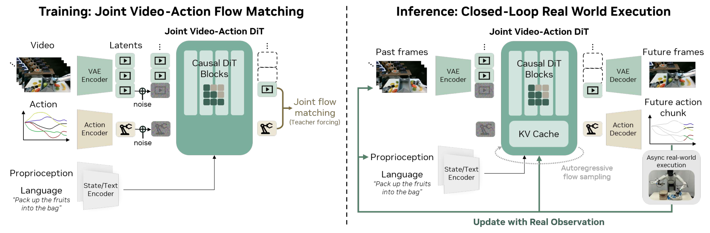
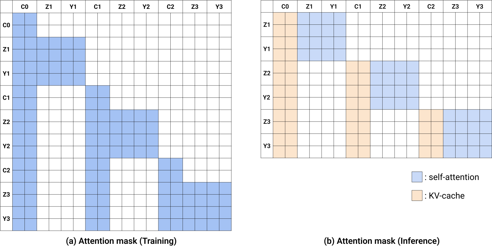
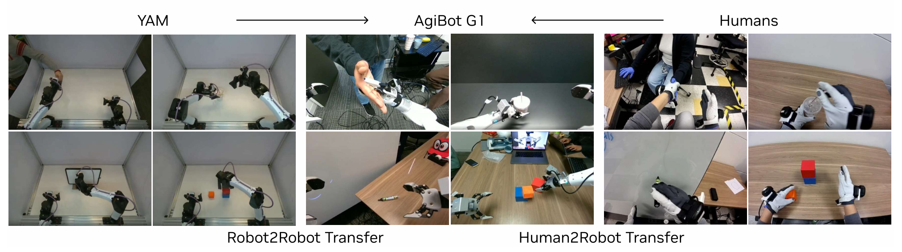
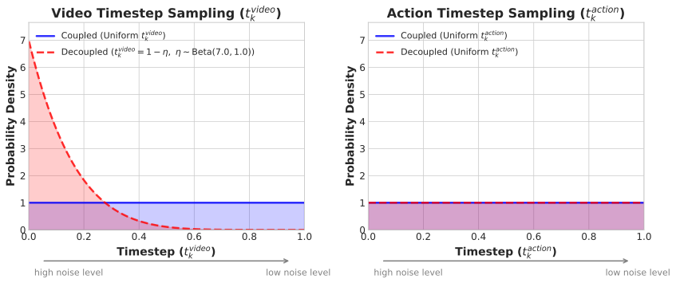

# DreamZero

**画面和动作，怎样在同一次去噪里生成？**

用一段开袋示范训练时，DreamZero 把两种记录按时间配齐。相机拍到滑扣从左到右，机器人同时记录手腕与夹爪的控制量。它让同一个扩散 Transformer 同时补全这两条序列。部署时，「滑扣接下来怎样移动」和「这段时间夹爪怎样动作」是同一轮生成的两个输出。[§3.1 联合预测](https://arxiv.org/html/2602.15922#S3.SS1)

## 联合生成具体发生在哪里？

主干来自 Wan2.1 的 14B 图生视频模型。多台相机的画面先拼成一幅，再压成视频潜在表示。文字指令和当前本体状态也进入模型，后者提供相机不一定能看清的关节位置等信息。训练把轨迹切成短段，以之前的真实片段作条件，对当前段的视觉表示和动作同时加噪。标准版在一段内为两种模态选用相同的噪声进度，模型在每轮都预测两边的更新方向。因此，动作开始成形时，视频本身也还处在生成途中。[§3.1 架构与训练目标](https://arxiv.org/html/2602.15922#S3.SS1) · [§4.1 主干与数据](https://arxiv.org/html/2602.15922#S4.SS1)

*视觉历史、语言和本体状态进入同一主干，未来视觉与对应动作在同一段内生成。* [DreamZero 原文](https://arxiv.org/html/2602.15922v1#S2.F4)

## 上一段猜错以后，下一段以什么为准？

段内，视频和动作一起去噪。跨段，模型按时间保留视觉历史。假设模型预测滑扣会移到袋口中间，机械臂实际执行后，相机却拍到袋子整个被拖走。下一轮会把实拍编码后写回注意力缓存，替换对应的预测画面。于是「袋子已经移位」成了下一段的输入。是否能重新抓好仍取决于动作策略，但上一次想象的滑扣位置不会作为事实一直传下去。[训练与推理掩码](https://arxiv.org/html/2602.15922#A3.F14) · [闭环推理](https://arxiv.org/html/2602.15922#S3.SS1)

*区分训练时的干净历史与推理时由真实相机更新的缓存。* [DreamZero 原文](https://arxiv.org/html/2602.15922v1#A3.F14)

## 没有动作标签的视频又怎样用？

人手开袋的录像也能教视频分支预测「怎样的画面会接在后面」。在作者的跨机器人及人类视频迁移设置里，这些额外录像只提供视觉目标，同时混入目标机器人带控制标签的轨迹，继续训练视频与动作的对应关系。回看 Motus，同一条人手录像会被赋予一个从光流中提取的潜在动作。DreamZero 用这条录像训练视觉预测，两种训练信号在共享主干中汇合。[跨身体视频的训练设置](https://arxiv.org/html/2602.15922#S5.SS1.SSS0.Px4) · [Motus 的潜在动作](https://arxiv.org/html/2512.13030#S4.SS2)

*另一台机器人或人类提供示范视频，目标机器人的轨迹继续提供动作标签。* [DreamZero 原文](https://arxiv.org/html/2602.15922v1#S5.F11)

**Flash 改了哪一步？** 标准版让视频和动作以相同进度去噪。Flash 在训练时分开安排两者的噪声，特意让视频在较高噪声下停留，让模型在画面还很粗略时也练习生成干净动作。少步推理时，控制器便可以从这幅粗略的视觉未来中取出动作。[§3.2.5 DreamZero-Flash](https://arxiv.org/html/2602.15922#S3.SS2.SSS5)

*比较两种训练安排，Flash 让视频更常停留在高噪声区，同时训练动作去噪。* [DreamZero 原文](https://arxiv.org/html/2602.15922v1#S3.F5)
