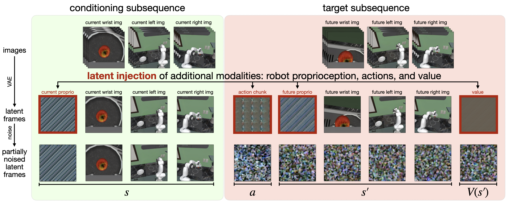
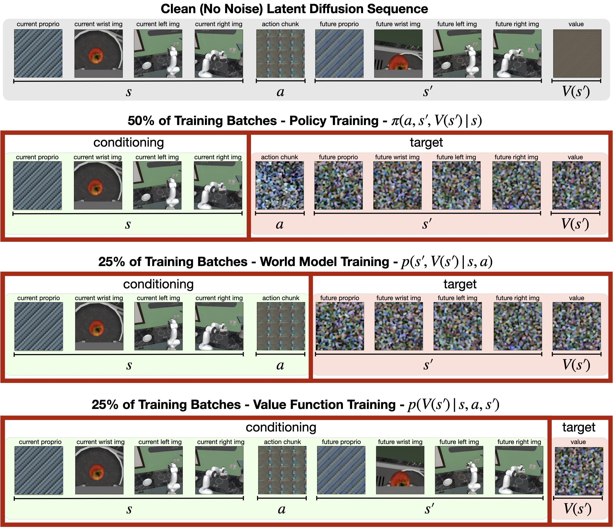
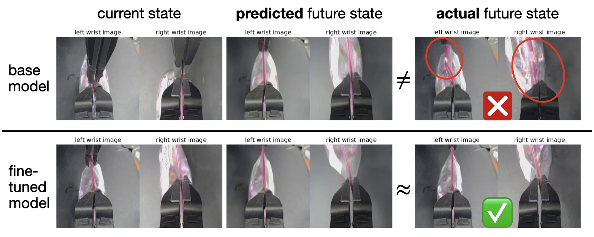

# Cosmos Policy

**给每种拉法预测一个终点，怎样据此选动作？**

假设机器人已经提出两种动作，一种水平拉滑扣，另一种略向上提再拉。要在动手前选出一种，先要知道每种拉法可能把袋子变成什么样，还要知道这样的结果离完成任务有多近。Cosmos Policy 让同一个视频扩散架构学会提出动作、预测后果和估计价值，再按需要组合这三种能力。[§4 从视频生成到控制和规划](https://arxiv.org/html/2601.16163#S4)

## 把动作和价值放进视频模型的什么位置？

Cosmos-Predict2 原本在一串压缩过的视频帧上做扩散。作者保留这套网络，为机器人数据安排新的「帧位」。相机图像照常编码，关节位置、整段动作或一个价值分数则先归一化，再重复填入与视觉潜在帧同形状的张量。张量处在哪个位置，就决定了那里表达的是画面、控制量还是价值。于是原有的扩散网络也能生成一段数值动作，无须为机器人另接动作专家。[§4.1 潜在帧注入](https://arxiv.org/html/2601.16163#S4.SS1)

序列依次包含当前状态 $s$、动作段 $A$、终点状态 $s'$ 与终点价值。

状态包含本体读数和相机观测。s′ 对应这段动作结束的时刻，两个状态之间隔着整段控制指令。这里预测的是终点快照。

*按帧位辨认本体状态、相机观测、动作段与终点价值。* [Cosmos Policy 原文](https://arxiv.org/html/2601.16163v1#S3.F2)

## 同一条轨迹，如何教会三种能力？

如果只给当前状态，模型练习补齐动作、终点和价值，这是策略训练。如果再给动作，就练习预测这段动作会把世界带到哪里、结果值多少。如果连终点也给了，就只剩价值要估计。价值的监督来自轨迹最后的成败或得分，经折扣得到回报。给定的部分不同，同一份轨迹就能教模型回答不同的问题。直接执行时可以并行生成几个输出，只把动作发给机器人。[§4.2 条件与预测目标](https://arxiv.org/html/2601.16163#S4.SS2)

*每行固定的前缀不同，剩余待生成的位置决定这一轮在学策略、动力学还是价值。* [Cosmos Policy 原文](https://arxiv.org/html/2601.16163v1#A1.F12)

## 规划模式为什么还要看机器人自己的失手记录？

成功示范擅长教机器人提出可行的拉法。要辨认「看起来像在拉，滑扣其实已脱落」的情形，还需要见过策略自己执行后的结果。作者保留原来的策略来提出候选，另取一份权重，用记录了成败或部分得分的实际执行轨迹继续训练，侧重修正后果预测和价值估计。规划时，两份权重各有分工。[§4.3 从执行轨迹学习](https://arxiv.org/html/2601.16163#S4.SS3)

对同一张开袋画面，策略采样多段拉法。规划模型对每个候选多次预测终点，再对每个终点多次估值。具体做法是先按阈值把这些估值归为成功或失败，找出票数较多的一组，只在这一组里取平均，得到该候选的分数。最后执行分数最高的动作段。这样，画面里「滑扣走了」和「整只袋子走了」的区别，就有机会通过终点评分改变实际发出的指令。[候选采样与价值聚合](https://arxiv.org/html/2601.16163#S4.SS3) · [滑扣示例](https://arxiv.org/html/2601.16163#S5.F6)

*看夹爪松开滑扣的位置，再比较两行模型对同一动作后果的预测。* [Cosmos Policy 原文](https://arxiv.org/html/2601.16163v1#S5.F6)
